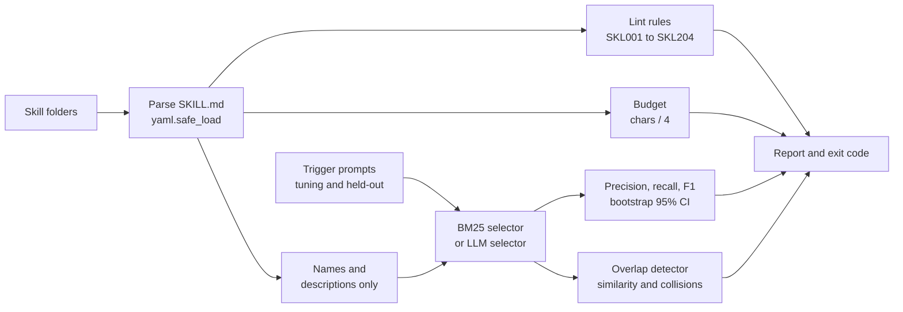

# skilltrial

[](https://github.com/shreyas-tech7/skilltest/actions/workflows/ci.yml)

**Status:** v0.1.0-rc1, a release candidate. It works offline and every number below comes from a committed results file. The repo is private and named `skilltest`. The package and command are `skilltrial`, because the name `skilltest` is taken on npm.

<!-- BEGIN:headline -->
Held-out trigger F1 0.881 (95% CI 0.804 to 0.949) for the offline BM25 baseline on 84 synthetic prompts. Planted overlaps found: 3 of 3.
<!-- END:headline -->

## The problem

An Agent Skill is a folder with a `SKILL.md` file. The agent reads only the name and description of every skill at startup. It loads the full instructions only when it decides a skill fits the request. So the description does two jobs. It must follow the spec, and it must make the agent pick this skill for the right requests and skip it for the wrong ones.

Validators already check the first job. Few tools measure the second. A vague description never fires. A greedy one fires on requests that belong to a sibling skill and burns context on instructions nobody needed. skilltrial checks both, offline, in CI. Think of it as pytest for skills.

It does four things:

1. `lint`: checks frontmatter and structure against the spec. Every rule has an ID, a severity and a fix hint.
2. `budget`: estimates tokens for the metadata, the body and each referenced file.
3. `trigger`: runs a selector over prompts that should and should not trigger each skill, then reports precision, recall and F1 with bootstrap intervals and a confusion table.
4. `overlap`: flags pairs of skills whose descriptions compete and lists the prompts where they collide.

## How it works



## Results

The prompts are synthetic. They were written for this repo, and some are ambiguous at the edges on purpose, so a perfect score is not the goal.

<!-- BEGIN:setup -->
There are 12 example skills with 10 should-trigger prompts and 5 should-not prompts each, 180 in all.
<!-- END:setup -->

The split into tuning and held-out sets was committed before any selector code existed, and the selector was tuned on the tuning set only. A "none" prompt should trigger no skill. Precision counts every skill the selector picked. Recall counts every prompt whose gold answer is a skill.

<!-- BEGIN:results -->
Run date 2026-11-20. Selector: BM25 baseline, offline, no model. Tuned on the tuning set only: k1 2.0, b 1.0, threshold 3.25 (split seed 20261120). The second split (seed 20261121) was tuned again on its own tuning set: k1 0.6, b 0.75, threshold 2.25. Intervals: percentile 95% bootstrap over prompts, 2000 resamples, seed 20261120.

| Set | Prompts (skill / none) | Precision | Recall | F1 | False trigger rate on none prompts |
| --- | --- | --- | --- | --- | --- |
| Tuning | 96 (60 / 36) | 0.753 (0.645 to 0.846) | 0.917 (0.837 to 0.983) | 0.827 (0.741 to 0.894) | 0.417 (0.261 to 0.579) |
| Held-out | 84 (60 / 24) | 0.897 (0.810 to 0.967) | 0.867 (0.776 to 0.948) | 0.881 (0.804 to 0.949) | 0.125 (0.000 to 0.263) |
| All | 180 (120 / 60) | 0.817 (0.748 to 0.879) | 0.892 (0.832 to 0.946) | 0.853 (0.796 to 0.902) | 0.300 (0.183 to 0.424) |
| Second split: tuning | 96 (60 / 36) | 0.779 (0.676 to 0.873) | 0.883 (0.797 to 0.957) | 0.828 (0.742 to 0.900) | 0.278 (0.138 to 0.432) |
| Second split: held-out | 84 (60 / 24) | 0.809 (0.714 to 0.901) | 0.917 (0.839 to 0.983) | 0.859 (0.785 to 0.928) | 0.417 (0.210 to 0.609) |

LLM selector: not reported. Record mode could not run on 2026-11-20 (no provider key, and the proxy refused api.groq.com). See BLOCKERS.md B3.
<!-- END:results -->

The held-out score came out a little higher than the tuning score. The held-out set is small, so that is within noise. A second split with a new seed was tuned and scored too, and both rows are above.

### Where the baseline gets confused (held-out)

<!-- BEGIN:confusion -->
| Gold | Picked | Prompts |
| --- | --- | --- |
| csv-cleanup | mock-data | 2 |
| none | release-notes | 2 |
| sql-helper | none | 2 |
| commit-message | none | 1 |
| image-resize | none | 1 |
| image-resize | thumbnail-maker | 1 |

| Skill | Precision | Recall | F1 |
| --- | --- | --- | --- |
| changelog-writer | 1.00 (5 of 5) | 1.00 (5 of 5) | 1.00 |
| commit-message | 1.00 (4 of 4) | 0.80 (4 of 5) | 0.89 |
| csv-cleanup | 1.00 (3 of 3) | 0.60 (3 of 5) | 0.75 |
| dockerfile-review | 0.83 (5 of 6) | 1.00 (5 of 5) | 0.91 |
| image-resize | 1.00 (3 of 3) | 0.60 (3 of 5) | 0.75 |
| meeting-notes | 1.00 (4 of 4) | 0.80 (4 of 5) | 0.89 |
| mock-data | 0.71 (5 of 7) | 1.00 (5 of 5) | 0.83 |
| regex-builder | 1.00 (5 of 5) | 1.00 (5 of 5) | 1.00 |
| release-notes | 0.71 (5 of 7) | 1.00 (5 of 5) | 0.83 |
| sql-helper | 1.00 (3 of 3) | 0.60 (3 of 5) | 0.75 |
| thumbnail-maker | 0.83 (5 of 6) | 1.00 (5 of 5) | 0.91 |
| unit-test-writer | 1.00 (5 of 5) | 1.00 (5 of 5) | 1.00 |
<!-- END:confusion -->

### Overlaps

Some pairs of example skills were written to compete on purpose (`examples/PLANTED_OVERLAPS.json`).

<!-- BEGIN:overlap -->
Thresholds fixed before the first run: description similarity 0.2 or more, or 2 or more colliding prompts (second score at least 0.8 of the first). Planted pairs found: 3 of 3. Other flagged pairs: 2.

| Pair | Planted | Similarity | Colliding prompts | Shared terms |
| --- | --- | --- | --- | --- |
| mock-data and unit-test-writer | yes | 0.54 | 2 | data, fake, fixtur, test, unit, user |
| changelog-writer and release-notes | yes | 0.47 | 2 | ask, chang, commit, git, last, merg |
| image-resize and thumbnail-maker | yes | 0.35 | 2 | imag, photo, resiz, smaller, user, version |
| dockerfile-review and image-resize | no | 0.24 | 0 | imag, user |
| changelog-writer and commit-message | no | 0.17 | 2 | ask, commit, git, user, writ |
<!-- END:overlap -->

### Lint output

CI runs `skilltrial lint examples/skills` on every push. The block below is the same command run locally and saved in `results/lint_examples.txt` by `skilltrial readme`. The run over the flawed variants shows what findings look like.

<!-- BEGIN:lint -->
```text
$ skilltrial lint examples/skills
12 skills checked: 0 errors, 0 warnings

$ skilltrial lint examples/flawed   (first 6 lines)
csv-cleanup: SKL001 error [spec] no SKILL.md in the folder (found skill.md, the name is case sensitive). Fix: add a file named exactly SKILL.md
commit-message: SKL002 error [spec] SKILL.md does not start with a '---' frontmatter block closed by another '---' line. Fix: start SKILL.md with a YAML mapping between two '---' lines
image-resize: SKL003 error [spec] name is missing. Fix: add a name field that matches the folder name
image-resize-and-convert-and-convert-and-convert-and-convert-and-convert-tool: SKL004 error [spec] name has 77 characters, the spec allows 1 to 64. Fix: shorten the name to 64 characters or fewer
Image_Resize: SKL005 error [spec] name 'Image_Resize' has characters the spec does not allow: 'IR_'. Fix: use lowercase letters, digits and hyphens only
image-resize-: SKL006 error [spec] name 'image-resize-' starts or ends with a hyphen. Fix: remove the leading or trailing hyphen
...
23 skills checked: 13 errors, 12 warnings
```
<!-- END:lint -->

### Budgets of the example skills

<!-- BEGIN:budget -->
Token counts are estimates: ceil(characters / 4). No tokenizer is used. The numbers match an independent count with `wc -m` (scripts/hand_count.sh).

| Skill | Metadata tokens | Body tokens | Lines | Referenced file tokens | Flags |
| --- | --- | --- | --- | --- | --- |
| changelog-writer | 63 | 249 | 44 | 54 | none |
| commit-message | 49 | 138 | 22 | 0 | none |
| csv-cleanup | 54 | 157 | 24 | 146 | none |
| dockerfile-review | 54 | 146 | 23 | 51 | none |
| image-resize | 52 | 121 | 22 | 0 | none |
| meeting-notes | 48 | 125 | 22 | 37 | none |
| mock-data | 47 | 132 | 22 | 0 | none |
| regex-builder | 55 | 158 | 22 | 65 | none |
| release-notes | 67 | 178 | 38 | 0 | none |
| sql-helper | 59 | 176 | 24 | 39 | none |
| thumbnail-maker | 57 | 115 | 22 | 0 | none |
| unit-test-writer | 49 | 138 | 23 | 0 | none |
<!-- END:budget -->

### Agreement with skills-ref

<!-- BEGIN:skillsref -->
skills-ref (agentskills, version 0.1.1, run 2026-11-20) and skilltrial agree on 31 of 35 skills (12 clean examples and every flawed variant). They differ on 4: SKL001, SKL012, SKL013, SKL201. See [docs/SKILLS_REF.md](docs/SKILLS_REF.md).
<!-- END:skillsref -->

## Cost per task

<!-- BEGIN:cost -->
| Task | Time (2 cores, Intel(R) Xeon(R) Processor @ 2.10GHz, Python 3.13.18, 2026-11-20, median of 5) | Cost |
| --- | --- | --- |
| Lint the 12 example skills | 6.58 ms (0.549 ms per skill) | $0.00 |
| Select a skill for 180 prompts | 2.69 ms (0.0149 ms per prompt) | $0.00 |

BM25 and lint run locally. No API calls, so the cost is zero.
<!-- END:cost -->

## 10-minute run guide

The repo is private for now, so the clone works only for people with access until it goes public.

```bash
git clone https://github.com/shreyas-tech7/skilltest.git
cd skilltest
./init.sh                                   # venv, install, ruff, every test offline
source .venv/bin/activate
skilltrial lint examples/skills             # spec lint, exit 1 on any error
skilltrial lint examples/flawed --strict    # see every rule fire (exits 1, as it should)
skilltrial budget examples/skills           # token estimates
skilltrial trigger examples/skills          # held-out precision, recall, F1
skilltrial overlap examples/skills          # competing descriptions
```

To test your own skills, put them in a folder and add a `triggers/` folder next to it with one YAML file per skill:

```yaml
skill: my-skill
should_trigger:
  - a request that should pick my-skill
should_not_trigger:
  - a nearby request that no skill should take
```

Then run `skilltrial trigger my-skills --prompts my-triggers --split all --untuned`.

### Exit codes

| Code | Meaning |
| --- | --- |
| 0 | No findings at the failing level |
| 1 | Findings: a lint error (or any warning with `--strict`), a budget over the guidance with `--strict`, F1 under `--min-f1`, a flagged pair with `--fail-on-overlap`, or a `--check` that found drift |
| 2 | Usage error, for example an unknown command or option |
| 3 | No skill folders found, or the prompt files are missing or invalid, or the LLM selector has no recording |

Every code is tested in `tests/test_cli.py`.

### GitHub Action

```yaml
- uses: shreyas-tech7/skilltest@v0.1.0-rc1
  with:
    path: skills
    strict: "false"
```

### pre-commit hook

```yaml
repos:
  - repo: https://github.com/shreyas-tech7/skilltest
    rev: v0.1.0-rc1
    hooks:
      - id: skilltrial-lint
        args: ["skills"]
```

## Limits

- The prompts are synthetic and written by the same build that wrote the skills. Real users phrase things in ways these prompts do not cover.
<!-- BEGIN:size -->
- 180 prompts is small. The held-out set has 84 prompts and only 24 none prompts, so the false trigger rate has a wide interval.
<!-- END:size -->
- BM25 matches words, not meaning. It misses paraphrases with no shared words and it is fooled by shared boilerplate such as "use when the user".
- The BM25 baseline is not the selector a real agent uses. Real agents use a language model. The LLM selector exists but record mode could not run here, so no LLM numbers are reported.
- Token counts are estimates (characters divided by 4). Real tokenizers differ, more so for code and non-English text.
- The overlap detector also flags pairs that were not planted. The dockerfile-review and image-resize pair is a false alarm, because "image" means a container image in one skill and a picture in the other. The changelog-writer and commit-message pair is a fair flag, because both answer requests about git history.
- The spec can change. The rules follow the spec text fetched on the date in [docs/SPEC.md](docs/SPEC.md).

## Glossary

- **Agent Skill:** a folder with a `SKILL.md` file that teaches an agent one task.
- **Frontmatter:** the YAML block between two `---` lines at the top of `SKILL.md`.
- **Progressive disclosure:** the agent loads names and descriptions first, the body when a skill fires, and other files only when needed.
- **Trigger:** the agent picking a skill for a request.
- **Precision:** of the skills the selector picked, the share that were right.
- **Recall:** of the prompts that should pick a skill, the share that picked the right one.
- **F1:** the harmonic mean of precision and recall.
- **False trigger:** a skill fires on a prompt that no skill should take.
- **BM25:** a classic keyword ranking formula from search engines.
- **Bootstrap interval:** resample the prompts many times and take the middle 95% of the scores.
- **Held-out set:** prompts the selector never saw while it was tuned.

## Related work

- [validate-skill](https://github.com/flash-brew-digital/validate-skill) and the reference validator [skills-ref](https://github.com/agentskills/agentskills) check structure. skilltrial compares its verdicts with skills-ref above.
- Anthropic's skill-creator skill also tests triggering, inside an agent session.
- Cisco's [skill-scanner](https://github.com/cisco-ai-defense/skill-scanner) checks skills for security threats, which is a different job. Its result on the examples is in [docs/SECURITY_CHECKS.md](docs/SECURITY_CHECKS.md).
- The npm package `skilltest` also calls itself a testing framework for Agent Skills. skilltrial is a separate Python tool and does not share code with it.

skilltrial is offline first and built for CI. It adds trigger precision and recall with intervals, token budgets and overlap reports.

## How this was built

AI agents wrote most of the code under Shreyas's direction. The full build prompt is in [docs/build/BUILD_PROMPT.md](docs/build/BUILD_PROMPT.md). Design choices are in [DECISIONS.md](DECISIONS.md) and failures are in [BLOCKERS.md](BLOCKERS.md).

Human checks, not done yet:

- Shreyas has not yet read the code or the diff.
- Shreyas has not yet rerun `./init.sh` on his own machine.
- Shreyas has not yet tried skilltrial on his own skills.

MIT License. Copyright (c) 2026 Shreyas.
